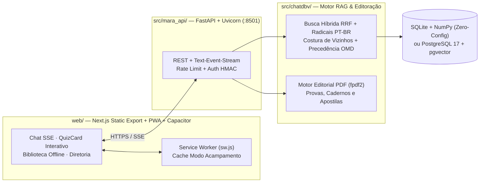

# Mara — IA dos Desbravadores (DSA)

[](./LICENSE)
[](https://github.com/edmiltonmartins/mara-dbv/actions/workflows/ci.yml)
[](https://www.python.org/)
[](./web)

**Mara** (*inspirada na saudação Maranata*) é uma assistente virtual de Inteligência Artificial, instrutora de classes e biblioteca offline de bolso criada por **Edmilton Cabral Martins Junior** sob o selo autoral **[Infinito Soft](https://infinitosoft.com)** para apoiar **Clubes de Desbravadores** na Divisão Sul-Americana (DSA).

Diferente de chatbots genéricos que inventam medidas de insígnias ou desconhecem resoluções recentes, a Mara opera com **RAG Híbrido estrito (*Retrieval-Augmented Generation*)** sobre **48 documentos oficiais da DSA** — priorizando automaticamente as **OMDs (Orientações do Ministério de Desbravadores)** vigentes sobre textos antigos.

- **Demonstração Oficial Online:** [mara.infinitosoft.com](https://mara.infinitosoft.com)

---

## Principais Recursos

- **Consulta Normativa com Citação de Página (SSE Streaming):** respostas em tempo real fundamentadas no *Manual Administrativo* completo, *Cartões de Classes*, *Notas Explicativas do RUD*, *Orientações 2026*, *Espaço da Calma (MAP/MDA)* e nas **20 OMDs oficiais (`001` a `021/2024`)**.
- **Simulado Interativo + Prova Impressa com Gabarito Separado:**
  - Resolução clicável direto na tela do celular (`Aspirante`, `Classes Regulares` ou `Liderança`) com correção imediata e explicação da página oficial;
  - Exportação editorial em **PDF A4** com linhas vetoriais de cabeçalho, bolhas de marcação `○` na Página 1 e **Folha do Instrutor (Gabarito Comentado)** isolada automaticamente na Página 2.
- **Modo Acampamento Offline (PWA Instalável):** funciona como aplicativo nativo no Android, iOS e Desktop, mantendo os **14 guias rápidos da Biblioteca do Conselheiro** (mapa milimétrico do RUD, gemas bíblicas de Amigo a Guia, nós e amarras, OMDs vigentes e VI Campori 2027) acessíveis mesmo **sem sinal de internet no acampamento**.
- **Blindagem Infantojuvenil & *Zero-Token Guard*:** travas dedicadas para proteção de juvenis (10 a 15 anos), rate-limiting por dispositivo/IP e interceptação local em `< 5 ms` para saudações e perguntas fora de escopo (zero consumo de tokens).
- **Painel da Diretoria:** gestão protegida por cookie `HttpOnly` assinado (`HMAC-SHA256`) para configurar o nome do clube nos cabeçalhos de prova, fazer upload de novos PDFs regionais e acompanhar métricas de aprovação.

---

## Arquitetura do Sistema (v2.0)



---

## Como Executar em 3 Minutos

### Opção A — Via Docker (Recomendado)

1. Clone o repositório e configure sua chave gratuita do [Google AI Studio](https://aistudio.google.com/apikey):
   ```bash
   git clone https://github.com/edmiltonmartins/mara-dbv.git
   cd mara-dbv
   cp .env.example .env
   # Edite o arquivo .env adicionando GEMINI_API_KEY=... e uma ADMIN_PASSWORD forte
   ```
2. Construa e suba o container unificado (*multi-stage* Node 24 + Python 3.12):
   ```bash
   docker build -t mara-dbv:2.0 .
   docker run --rm -p 8501:8501 --env-file .env mara-dbv:2.0
   ```
3. Acesse **`http://localhost:8501`** no navegador.

---

### Opção B — Ambiente de Desenvolvimento Local (Python + Node.js)

```bash
# 1. Backend Python e indexação dos 48 documentos oficiais em SQLite local
python -m venv .venv
# Linux/macOS: source .venv/bin/activate  |  Windows PowerShell: .\.venv\Scripts\Activate.ps1
pip install -r requirements.txt
cp .env.example .env   # preencha GEMINI_API_KEY no .env
python scripts/ingest.py

# 2. Compilação estática do Aplicativo Web / PWA
cd web
npm install
npm run build
cd ..

# 3. Servidor unificado na porta 8501
uvicorn --app-dir src mara_api.main:app --host 127.0.0.1 --port 8501
```

Para executar a suíte de testes automatizados:
```bash
pytest -v
npm --prefix web run typecheck
```

---

## Empacotamento Nativo Android / iOS (Capacitor)

O diretório `web/` já inclui [`capacitor.config.ts`](./web/capacitor.config.ts) pré-configurado:
```bash
cd web
npm run build
npx cap add android   # ou npx cap add ios
npx cap sync
```

---

## Como Contribuir e Governança

Contribuições de desenvolvedores, regionais, conselheiros e instrutores são muito bem-vindas!

1. Leia o **[Guia de Contribuição (`CONTRIBUTING.md`)](./CONTRIBUTING.md)** e o **[Código de Conduta (`CODE_OF_CONDUCT.md`)](./CODE_OF_CONDUCT.md)**;
2. Todo *Pull Request* exige a leitura e concordância expressa com o **[Acordo Individual de Licença de Contribuidor (`CLA.md`)](./CLA.md)** em favor do titular autoral;
3. Para relatar falhas de segurança de forma privada, siga as instruções em **[`SECURITY.md`](./SECURITY.md)**.

---

## Licença, Titularidade Autoral e Direitos da DSA

- **Código-Fonte:** Distribuído sob a licença **[GNU Affero General Public License v3.0 (`GNU AGPL-3.0-only`)](./LICENSE)** — Copyright (C) 2026 **Edmilton Cabral Martins Junior** `<junior.edmilton@gmail.com>` (selo *Infinito Soft*). Qualquer versão modificada disponibilizada em rede deve manter o código-fonte aberto sob a mesma licença (Seção 13) e preservar os avisos legais em **[`NOTICE.md`](./NOTICE.md)**.
- **Nome Fantasia e Sinais Distintivos:** O nome do autor, o selo **"Infinito Soft"** e seus logotipos oficiais são sinais distintivos reservados e **não** estão cobertos pela licença de código aberto (veja Seção 2 do [`NOTICE.md`](./NOTICE.md)).
- **Materiais Institucionais DSA / IASD:** Os manuais, OMDs, cartões e emblemas oficiais dos Desbravadores pertencem exclusivamente à **Divisão Sul-Americana da Igreja Adventista do Sétimo Dia (DSA)**, sendo utilizados neste projeto de forma gratuita e estritamente educacional/ministerial (veja Seção 3 do [`NOTICE.md`](./NOTICE.md)). A Mara é uma iniciativa tecnológica independente de apoio aos clubes e não substitui pronunciamentos oficiais dos campos da IASD.
